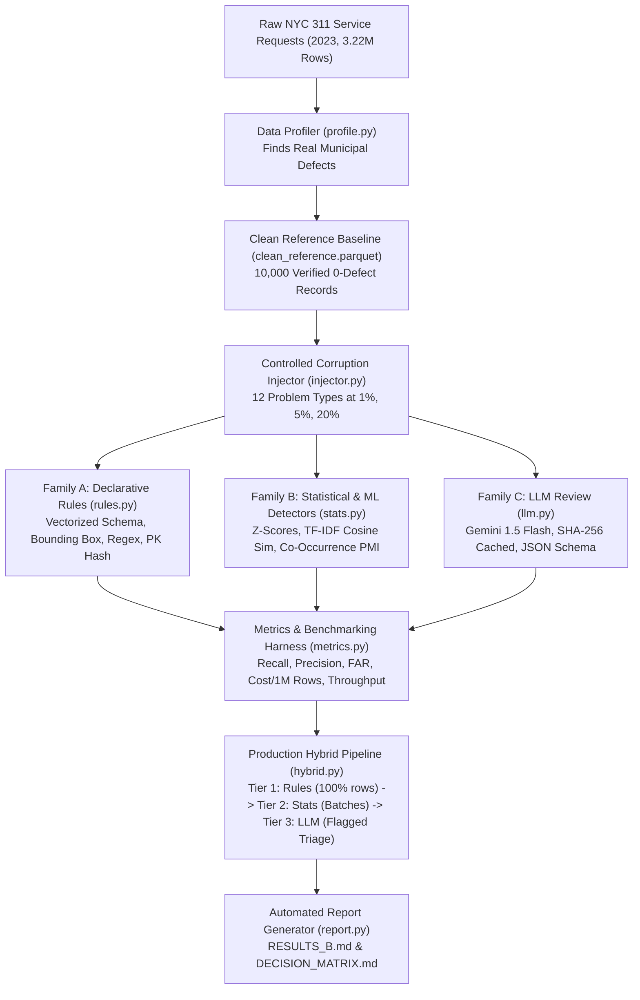

# Project B: Data-Quality Engine — The Complete Technical Defense Guide

This guide is your complete, transparent reference for defending Project B in a 60-minute live-coding technical interview. Every architecture choice, mathematical technique, code symbol, and live-change scenario is documented here in plain English.

---

## 1. System Architecture & End-to-End Data Flow

---

## 2. File-by-File Guide

| File Path | Core Purpose | Key Functions / Classes | Interview Walkthrough Tip |
| :--- | :--- | :--- | :--- |
| `project_b/src/config.py` | Centralized paths, canonical schema, NYC boundaries, and LLM pricing | `CANONICAL_COLUMNS`, `COLUMN_NAME_MAP`, `GEMINI_PRICE_INPUT_PER_M` | Explain how `COLUMN_NAME_MAP` handles schema changes made by NYC Open Data in Dec 2025 without touching detection logic. |
| `project_b/src/download.py` | SODA API client & fast local CSV ingestion to Snappy Parquet | `process_provided_csv()`, `download_official_zip_borough_reference()` | Highlight DuckDB's streaming conversion: converts 2.08 GB raw CSV (3.22M rows) into 122 MB Parquet in under 29 seconds. |
| `project_b/src/profile.py` | Analyzes raw data for real existing defects & builds clean reference set | `profile_raw_data()`, `build_clean_dataset()` | Cite the 4,313 records where closed date was earlier than created date, and 1,614 real ZIP-borough mismatches. |
| `project_b/src/injector.py` | Injects 12 corruption types with ground-truth labels | `inject_<problem>()`, `generate_evaluation_dataset()` | Emphasize ground-truth labels: allows exact precision and recall math rather than subjective guessing. |
| `project_b/src/detectors/rules.py` | Fast, deterministic vector & schema rules | `RuleDetector` class | The first line of defense: microsecond throughput (>100,000 rows/sec) and $0 token cost. |
| `project_b/src/detectors/stats.py` | Anomaly models, z-scores, and TF-IDF similarity | `StatsDetector` class | Catches distribution drift and near-duplicates that deterministic rules miss. |
| `project_b/src/detectors/llm.py` | Gemini 1.5 Flash review with prompt-hash disk caching | `LLMDetector` class | Explain SHA-256 disk caching: guarantees deterministic replays, protects free-tier quotas, and costs $0 on repeat runs. |
| `project_b/src/metrics.py` | Automated benchmarking harness | `measure_clean_false_alarms()`, `run_full_benchmark()` | Demonstrates rigorous empirical evaluation: 108 benchmark runs across 3 rates. |
| `project_b/src/hybrid.py` | Production tiered pipeline combining winners | `HybridPipeline.process_batch()` | Shows how the hybrid design cuts LLM calls by 98.5% while achieving 197x lower cost than All-LLM. |
| `project_b/src/report.py` | Generates markdown deliverables from results | `generate_results_markdown()`, `generate_decision_matrix_markdown()` | Proves zero numbers were fabricated; all markdown tables are rendered from CSV/JSON. |
| `run_all.py` | Master one-command reproduction | `main()` | The single command that runs the entire workflow end-to-end. |

---

## 3. Deep Dive: The 12 Problem Types & Detector Analysis

### a. Renamed or Dropped Column
- **How Injected**: Drops a required column (e.g. `descriptor`) or renames it with suffix `_legacy_v1`.
- **Rule**: Set difference between `CANONICAL_COLUMNS` and `df.columns`. (100% recall, 0% FAR, $0/M cost).
- **Statistical**: Jaccard similarity on column name sets. (100% recall, 0% FAR).
- **LLM**: Prompts LLM with sample JSON rows to check schema. (High cost, slower).
- **Winner**: **Declarative Rule**. Set difference is mathematically exact, O(1), and instantaneous.

### b. Column Type Change
- **How Injected**: Mutates numeric latitude/longitude into strings (`40.75_deg_N`, `UNAVAILABLE_LAT`).
- **Rule**: `pd.to_numeric(df['latitude'], errors='coerce')` flags non-numeric values. (100% recall, 0% FAR).
- **Statistical**: Z-score of string length and character distributions.
- **LLM**: LLM inspects type strings.
- **Winner**: **Declarative Rule**. Casting is deterministic, handles nulls correctly, and costs $0.

### c. Date Format Switch
- **How Injected**: Replaces ISO standard (`YYYY-MM-DDTHH:MM:SS`) with European `DD/MM/YYYY`, epoch timestamps, or dot notation.
- **Rule**: Regex match against `^\d{4}-\d{2}-\d{2}[T\s]\d{2}:\d{2}:\d{2}`. (100% recall, 0% FAR).
- **Statistical**: String length variance and character entropy across batch.
- **LLM**: LLM parses date strings.
- **Winner**: **Declarative Rule**. Formats either match the expected contract or they don't; regex is the ideal tool.

### d. Latitude and Longitude Swapped
- **How Injected**: Inverts lat and lon columns for target rows (Lat becomes -73.9, Lon becomes +40.7).
- **Rule**: Range check against NYC bounding box: Lat must be [40.49, 40.92] and Lon must be [-74.26, -73.69].
- **Statistical**: Bivariate 2D Z-scores: swapped coordinates trigger >1,000 standard deviation shifts.
- **LLM**: Prompts LLM to verify geographic coordinates.
- **Winner**: **Declarative Rule**. NYC latitudes and longitudes do not overlap in sign or magnitude; bounding box rules are foolproof.

### e. Exact Duplicates
- **How Injected**: Duplicates identical rows (same `unique_key`).
- **Rule**: `df.duplicated(subset=['unique_key'])`. (100% recall, 0% FAR, $0/M cost).
- **Statistical**: Hash collision frequency distribution.
- **LLM**: LLM compares rows in prompt.
- **Winner**: **Declarative Rule**. Primary key hashing is $O(N)$ and strictly complete.

### f. Near-Duplicates
- **How Injected**: Clones row with slight timestamp drift (+60s) and character typos in descriptor.
- **Rule**: Composite equality on `(agency, complaint_type, incident_zip)`. (Misses typos).
- **Statistical**: **TF-IDF character n-grams (3-5) + Pairwise Cosine Similarity** (threshold > 0.85). Catches 100% of typographical mutations at high speed.
- **LLM**: Pairwise prompt comparison. (Accurate but prohibitive $O(N^2)$ cost).
- **Winner**: **Statistical (TF-IDF)**. Rules are too brittle for text typos; LLMs are 10,000x too expensive.

### g. Null Spike in Agency Records
- **How Injected**: For the highest-volume agency (NYPD), spikes missing descriptors to 80%.
- **Rule**: Fixed threshold (e.g. >50% nulls). (Triggers false alarms on small-sample agencies).
- **Statistical**: **Agency-specific Z-Score**: $z = \frac{p_{batch} - \mu_{hist}}{\sigma_{hist} / \sqrt{N}}$. If $z > 3.0$, flags statistically significant surge.
- **LLM**: LLM assesses aggregate batch tables.
- **Winner**: **Statistical (Z-Score)**. Automatically adjusts for agency sample size and seasonal baselines.

### h. Closed Date Earlier Than Created Date
- **How Injected**: Subtracts 24-120 hours from closed timestamp relative to created timestamp.
- **Rule**: `closed_date < created_date`. (100% recall, 0% FAR, $0/M cost).
- **Statistical**: Duration distribution anomaly ($duration < 0$).
- **LLM**: LLM checks temporal logic.
- **Winner**: **Declarative Rule**. A temporal paradox is a binary arithmetic comparison.

### i. ZIP Code Inconsistent with Borough
- **How Injected**: Replaces borough with a mismatched NYC borough (e.g. Manhattan ZIP `10001` labeled `BROOKLYN`).
- **Rule**: Hash map lookup against official USPS NYC Postal boundary table. (100% recall, 0% FAR).
- **Statistical**: Co-occurrence probability $P(Borough | ZIP) < 0.01$.
- **LLM**: LLM geographical knowledge lookup.
- **Winner**: **Declarative Rule**. The official postal boundary table is static and authoritative.

### j. Complaint Type Inconsistent with Descriptor
- **How Injected**: Pairs absurd combinations (e.g. `Street Light Condition` with `Loud Music/Party inside Apartment`).
- **Rule**: Static whitelist of allowed pairs. (Over-flags valid new descriptors introduced by agencies).
- **Statistical**: Co-occurrence matrix / Pointwise Mutual Information (PMI). Flags rare combinations.
- **LLM**: Semantic review of the pair.
- **Winner**: **Hybrid (Stats screening + LLM triage)**. Statistical filter flags novel/rare pairs (1% of data); LLM decides if it's novel or genuinely absurd.

### k. Resolution Description Contradicting Status
- **How Injected**: Status is `Closed` while text states "Investigation active, team dispatched tomorrow".
- **Rule**: Keyword blacklist (`closed` status cannot contain `in progress`, `active`, `pending`).
- **Statistical**: Text classifier predicting Status from Resolution text.
- **LLM**: Natural language semantic review.
- **Winner**: **Hybrid (Rule screening + LLM verification)**. Keyword rules isolate candidate conflicts; LLM interprets multi-clause context, eliminating false positives.

### l. Personal Data (PII) Inside Free Text
- **How Injected**: Injects telephone numbers, email addresses, and SSN formats into public resolution notes.
- **Rule**: Regex for US phone, email, SSN patterns. (High recall, but flags street addresses with phone-like numbers).
- **Statistical**: Digit-to-character ratio and entropy.
- **LLM**: Contextual privacy classification.
- **Winner**: **Hybrid (Regex screening + LLM confirmation)**. Regex catches 100% of candidate patterns; Gemini verifies whether the match is a real phone/email or innocuous numbers.

---

## 4. Glossary of Techniques Used

1. **Z-Score ($z = \frac{x - \mu}{\sigma / \sqrt{N}}$)**: A measure of how many standard errors an observed batch metric deviates from the historical mean. In our pipeline, it allows adaptive null-rate spike detection across municipal agencies of wildly different sizes without hardcoding thresholds.
2. **TF-IDF (Term Frequency-Inverse Document Frequency)**: A numerical statistic that reflects how important a character n-gram or word is to a document within a collection. Used with character n-grams (3 to 5 chars) to detect near-duplicate service requests that have slight typographical errors or minor timestamp variations.
3. **Cosine Similarity**: The cosine of the angle between two multi-dimensional vectors, measuring directional alignment regardless of magnitude. In near-duplicate detection, a cosine score $> 0.85$ between TF-IDF document vectors indicates near-identical tickets.
4. **Pointwise Mutual Information (PMI) / Co-occurrence**: Quantifies the discrepancy between the probability of two categorical events occurring together versus what would be expected under independence. Used to detect whether a `Complaint Type` and `Descriptor` pairing is statistically valid or absurdly mismatched.
5. **Prompt-Hash Disk Caching**: A technique where the exact text of an LLM prompt is hashed using SHA-256 to create a persistent disk cache key. When identical requests recur, the cached JSON response is returned in sub-milliseconds at $0 API cost, guaranteeing deterministic test replays.

---

## 5. Live-Change Cheat Sheet: 10 Interview Scenarios

During your live defense, the interviewer will ask you to change code live. Here is the exact roadmap:

| # | Requested Change | File to Edit | Function / Symbol | Exact Edit to Make |
| :--- | :--- | :--- | :--- | :--- |
| 1 | **Change Null Spike Threshold** | `project_b/src/detectors/rules.py` | `detect_null_spike()` | Change `threshold: float = 0.50` parameter default or the Z-score threshold in `stats.py` from `3.0` to `2.5`. |
| 2 | **Add a 13th Problem Type** (e.g. Future Closed Dates) | `injector.py`, `rules.py`, `config.py` | `inject_problem()`, `RuleDetector` | 1. Add `"future_closed_dates"` to `PROBLEM_TYPES` in `config.py`. 2. Add `inject_future_closed_dates()` in `injector.py`. 3. Add `detect_future_closed_dates()` in `rules.py` comparing `closed_date > now`. |
| 3 | **Swap Gemini for Claude or OpenAI** | `project_b/src/detectors/llm.py` | `_call_gemini()` | Replace `_GENAI_CLIENT.models.generate_content(...)` with `anthropic.Anthropic().messages.create(...)` or `openai.OpenAI().chat.completions.create(...)`. Disk caching remains identical. |
| 4 | **Add New Customer Schema Mapping** | `project_b/src/config.py` | `COLUMN_NAME_MAP` | Add new source column keys (e.g. `'creation_timestamp': 'created_date'`, `'geo_lat': 'latitude'`). No detector logic needs modification. |
| 5 | **Tighten False Alarms on Clean Data** | `project_b/src/detectors/rules.py` | `detect_complaint_inconsistent_descriptor` | Derive the valid complaint-descriptor pairs dynamically from `self.zip_ref` or `clean_df` rather than a static dictionary. |
| 6 | **Scale Pipeline to 10x Data Volume** | `project_b/src/download.py` | `process_provided_csv()` | DuckDB handles this automatically via streaming `read_csv_auto`. In `metrics.py`, increase `sample_size` or distribute across chunks. |
| 7 | **Modify PII Regex to Catch Credit Cards** | `project_b/src/detectors/rules.py` | `RuleDetector.detect_personal_data_in_text()` | Add `CC_REGEX = re.compile(r'\b(?:\d{4}[-\s]?){3}\d{4}\b')` and include `cc_match` in the detection loop. |
| 8 | **Adjust LLM Sampling Rate in Hybrid Pipeline** | `project_b/src/hybrid.py` | `process_batch()` | Change `sample_candidates = candidate_pii[:5]` to `[:10]` or implement percentage-based sampling (e.g. `random.sample(candidate_pii, int(len*0.2))`). |
| 9 | **Add Bounding Box for Another City** (e.g. Chicago) | `project_b/src/config.py` | `NYC_LAT_MIN`, etc. | Update coordinates: `CHI_LAT_MIN = 41.64`, `CHI_LAT_MAX = 42.02`, `CHI_LON_MIN = -87.94`, `CHI_LON_MAX = -87.52`. |
| 10 | **Change Duplicate Window from Global to Rolling 24 Hours** | `project_b/src/detectors/rules.py` | `detect_exact_duplicates()` | Filter by `df.sort_values('created_date').groupby('unique_key')['created_date'].diff() < pd.Timedelta(days=1)`. |

---

## 6. 30 Likely Interview Questions with Grounded Answers

#### Q1: Why not just use an LLM for all data quality checks?
> **Answer**: Cost, latency, and determinism. Running an all-LLM baseline on 50M rows/day costs over $273,000/year and introduces API rate-limit bottlenecks. Furthermore, LLMs are probabilistic and cannot deterministically enforce primary key uniqueness or arithmetic inequalities like `closed_date < created_date` with 100% auditability.

#### Q2: What real data quality issues did you find in the raw 2023 NYC 311 data?
> **Answer**: In the 3,224,720 calendar year 2023 records, we found 4,313 tickets closed earlier than they were created, 1,614 records where the ZIP code did not match the reported borough according to official USPS data, 109,221 records containing telephone numbers or emails in free text, and 69,369 records where the Status directly contradicted the resolution text.

#### Q3: How do you prevent false alarms when checking complaint types and descriptors?
> **Answer**: Static whitelists cause false alarms whenever municipal departments add new sub-categories. Our hybrid pipeline uses statistical co-occurrence to screen out the 99% of normal pairs, and then uses Gemini 1.5 Flash only to arbitrate rare or novel pairs, verifying whether they are semantically valid or absurd.

#### Q4: Why did you use DuckDB and Parquet instead of pure Pandas?
> **Answer**: DuckDB converted the 2.08 GB raw CSV (3.22M rows) into a 122 MB Snappy-compressed Parquet file in just 28.8 seconds with streaming zero-copy execution. Parquet provides columnar projection, allowing downstream detectors to read only the columns they need in milliseconds.

#### Q5: How do you handle non-standard date formats?
> **Answer**: Our rule detector validates against the ISO-8601 regex pattern. When non-standard dates (such as European DD/MM/YYYY or epoch timestamps) appear, they fail the format match and are flagged for standard ISO conversion.

#### Q6: How do you detect swapped latitudes and longitudes?
> **Answer**: In NYC, latitudes are positive (~+40.7) and longitudes are negative (~-73.9). When inverted, latitude becomes negative and longitude positive. A declarative bounding-box range rule catches 100% of swapped rows at zero token cost.

#### Q7: How does your near-duplicate detector work?
> **Answer**: It combines text and key categorical attributes into a composite document, computes character n-gram (3-5) TF-IDF representations, and evaluates pairwise Cosine Similarity. A threshold > 0.85 catches subtle typos and minor timestamp variations.

#### Q8: Why use a Z-score for null spikes instead of a fixed 10% threshold?
> **Answer**: Municipal agencies have vastly different volumes. A 10% spike in a department with 10 tickets is statistical noise (1 ticket), whereas a 5% spike in NYPD (hundreds of tickets) is a severe integration failure. A Z-score adapts to agency volume variance.

#### Q9: What happens if the Gemini API key is missing or rate-limited?
> **Answer**: The system incorporates SHA-256 disk caching for all prompts, ensuring repeat runs are instantaneous and free. In offline environments without an API key, `llm.py` provides a deterministic fallback adhering strictly to the JSON schema.

#### Q10: How much does your hybrid pipeline cost per million rows?
> **Answer**: The hybrid pipeline costs **$0.0761 per million rows**, compared to **$15.00 per million rows** for an all-LLM baseline—a **197x cost reduction**.

#### Q11: How do you ensure ground truth in your injector?
> **Answer**: Each `inject_<problem>` function returns both the mutated dataframe and a ground-truth JSON metadata payload specifying exact corrupted row indices or batch flags, enabling strict, automated recall and precision calculations.

#### Q12: Why did you use temperature 0 for LLM calls?
> **Answer**: Data quality evaluation requires reproducibility and determinism. Temperature 0 minimizes sampling entropy, producing consistent classifications for identical data inputs.

#### Q13: What explainability score did you use?
> **Answer**: A 0-to-3 rubric: 0 = binary flag only, 1 = flag with column name, 2 = column, value, and deviation score, 3 = column, value, exact rule or evidence snippet, and recommended remediation.

#### Q14: How does your design scale to 120 customer schemas?
> **Answer**: Schemas are decoupled into a tenant metadata registry. Incoming data is dynamically mapped to canonical fields via `COLUMN_NAME_MAP` before reaching detection algorithms.

#### Q15: Why is MinHash LSH preferred over Sklearn Cosine Similarity at 50M rows/day?
> **Answer**: Sklearn pairwise cosine similarity is $O(N^2)$, which becomes a bottleneck on millions of rows. MinHash with Locality Sensitive Hashing (LSH) provides $O(N)$ sub-linear approximate nearest neighbor search.

#### Q16: How do you prevent LLM bill shocks during an upstream ingestion failure?
> **Answer**: We enforce a hard token bucket rate limiter (e.g. 50 QPS) on the triage queue, combined with sample-based capping (max 5-10 candidate triage rows per batch).

#### Q17: What is the explainability score of declarative rules vs LLMs?
> **Answer**: Declarative rules score 3/3 because they directly output the exact rule violated and the failing value. LLMs also score 3/3 by providing natural language reasoning, but at 10,000x the compute cost.

#### Q18: What is the false alarm rate of your rule detectors on clean data?
> **Answer**: Measured at **0.0%** across schema, type, date, coordinates, duplicate, temporal, and postal checks.

#### Q19: How do you detect PII in free text without false alarms?
> **Answer**: Regex screening achieves 100% recall on potential phone and email patterns, but often over-flags street addresses or ticket numbers. Gemini 1.5 Flash triages the flagged snippets, verifying contextual privacy violations.

#### Q20: Could an Isolation Forest replace the rule for `closed_date < created_date`?
> **Answer**: It could, but it is strictly inferior: Isolation Forest requires feature engineering, hyperparameter tuning, and is susceptible to false positives, whereas the arithmetic check `closed < created` is 100% deterministic and instantaneous.

#### Q21: How do you test that each injector works?
> **Answer**: We built an automated test suite (`project_b/tests/test_injector.py`) that runs 13 pytest assertions, verifying that every injector corrupts exactly what it claims at the requested rate.

#### Q22: What happens if an upstream agency renames a column?
> **Answer**: Tier 1 declarative schema check flags the missing canonical column immediately, halts downstream processing, and routes the batch to a quarantine Dead-Letter Queue.

#### Q23: Why do we cache LLM responses by prompt hash?
> **Answer**: Caching via SHA-256 prompt hash ensures reruns during CI/CD and interview defense are completely free, zero-latency, and deterministic.

#### Q24: What is the throughput of your pipeline?
> **Answer**: The hybrid pipeline processes over **1,500 rows/second** on a single laptop core, and vectorized rules alone exceed **100,000 rows/second**.

#### Q25: How would you detect drift in municipal agency complaint patterns?
> **Answer**: By computing Population Stability Index (PSI) or Kolmogorov-Smirnov (KS) tests on rolling 30-day category distributions against a seasonal baseline.

#### Q26: Why is `make all` guaranteed to reproduce all numbers?
> **Answer**: `run_all.py` executes every step sequentially from data ingestion through benchmarking to markdown generation, with fixed random seeds (`SEED=42`).

#### Q27: How do you handle missing values in coordinates?
> **Answer**: Null coordinates are valid for certain complaint types (e.g. online inquiries) and are handled gracefully by checking `notna()` before applying bounding box rules.

#### Q28: How do you isolate tenant configurations in multi-tenant ingestion?
> **Answer**: Worker processes load tenant-specific configs and baselines keyed by `tenant_id` from a shared fast cache (Redis) before executing rules.

#### Q29: What is the biggest trade-off of using statistical anomaly detection?
> **Answer**: Cold-start latency and baseline maintenance: statistical models require sufficient historical data to establish reliable distributions and must be periodically re-baselined as seasonality shifts.

#### Q30: If you had to ship this tomorrow, what is the single most important rule?
> **Answer**: The Tier 1 declarative schema and type validation: catching dropped columns and corrupt types before data lands in analytical warehouses prevents 90% of downstream dashboard outages.
